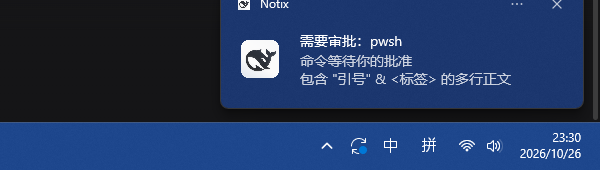

# Notix

[English](README.md) | 中文

[](#平台支持)
[](LICENSE)

为 [DeepSeek Harness](https://github.com/deepseek-ai/deepseek-harness) 提供桌面通知：agent **需要输入**、**运行过久**、**执行出错**或**任务完成**时提醒你，原生支持 **macOS 与 Windows**。一个包即可使用，无需额外 UI 包，不参与审批逻辑、不阻塞 agent。

Notix 是纯观察者：不注册审批/回答者、不向会话日志追加事件、不阻塞 agent。它只订阅共享事件面，通过可插拔渠道投递通知，内置 macOS 与 Windows 系统通知渠道。

> **状态：** `v0.3.0`，首个公开版本，支持 macOS 与 Windows。

## 平台支持

| 平台 | 渠道 | 投递后端 | 要求 |
|---|---|---|---|
| macOS | `macos-system` | 已签名 Notix Helper App → `terminal-notifier` → `alerter` → `osascript` | macOS；可选 Helper 用于显示鲸鱼图标 |
| Windows 10/11 | `windows-system` | 通过随包 PowerShell 助手发送 WinRT `ToastNotification` | 系统自带 Windows PowerShell 5.1，无需额外依赖 |

只注册当前平台对应的渠道，因此一份配置可在两端通用；声音、点击跳转与鲸鱼图标均可按渠道配置。

## 一个包，两个运行时入口

本项目只发布 `notix-dsh`，无需另外安装 `notix-dsh-ui`。同一个 manifest 同时声明 `dsh.bundle.patch` 与 `dsh.client`：

- `lib/index.js` 是 Node/Host 入口：事件触发、规则、投递渠道、历史、配置与 `ctx.notix` 服务。
- `lib/client.js` 是浏览器入口：在「插件」和「设置 → 插件」页面渲染 Notix 设置卡片。
- `cordis.patch.yml` 只创建一个 Loader 条目 `id: notix`。它加载 Host 半，同时让 Client 加载器发现本包的 `dsh.client` 声明。

两个入口仍拥有各自独立的运行时生命周期，合并的只是包结构与安装方式。

## 监听内容

| 触发 | 来源 | 默认 |
|---|---|---|
| 审批请求 | `approval/asked` / `approval/decided` 会话事件 | 开，5 分钟后重复提醒，最多 2 次 |
| 等待回答 | `userQuestions` 会话投影（按会话标记阻塞状态） | 开，5 分钟提醒 |
| 长 turn | `turn/start` 看门狗 | 开，10 分钟 |
| 长后台任务 | `job/registered` 看门狗 | 默认关，开启后 15 分钟 |
| turn 失败 | `turn/end` reason `error` + `agent/error`（合并去重） | 开，60 秒冷却 |
| 工具失败 | `tool/result` 带 `isError` | 关（按需开启） |
| turn 完成 | `turn/end` reason `completed` | 开，仅 ≥3 分钟的 turn |
| 后台任务结束 | `job/settled` | 默认关（按需开启） |

通知会去重、对错误通知按会话冷却、在免打扰时段静默、按渠道重试并熔断。最近 200 条历史存在 `notix` storage domain，可通过 `ctx.notix.history()` 读取。

## macOS 实际样式

当前 `osascript` 通道的通知横幅如下（标题 + 正文，右上角圆角浮动卡片）：


⚠️ 横幅左侧图标是 macOS 分配给发送进程的：`osascript` 通道下显示系统「脚本编辑器」图标，**不是** Notix 自己的图标（Notix 图标用于 dsh 插件列表/市场）：


### 让横幅显示鲸鱼图标（需要签名）

macOS 只允许**有有效代码签名身份**的 App 申请通知权限；ad-hoc 签名或未签名 App 会被系统直接拒绝（`requestAuthorization` 返回 denied，且不会弹授权框）。因此：

```bash
# 1) 构建通知助手 App（首次需 Xcode Command Line Tools）
NOTIX_SIGN_IDENTITY="Apple Development: 你的名字 (TEAMID)" \
  ./scripts/build-notifier-app.sh --install

# 2) 首次通知时在系统弹窗点「允许」；之后横幅左侧即为鲸鱼图标
```

没有证书时脚本会退回 ad-hoc 签名并打印警告。已安装的 ad-hoc helper 仍会被运行时优先选择，但通知会因未授权而投递失败；请移除/停用该 helper，或用有效签名重新构建。装好 `terminal-notifier` 时插件也会通过 `-appIcon` 显示鲸鱼图标。

## Windows 实际样式



Windows 操作中心原生 toast，归属显示为 **Notix** 并带鲸鱼图标：加粗标题、多行正文，可选声音与点击跳转。

## Windows 通知

内置 `windows-system` 渠道通过 Windows PowerShell 与 WinRT Toast API 发送原生 Windows 通知。Host 在 Windows 上运行时自动注册该渠道；macOS 上不注册 Windows 渠道，Windows 上也不注册 macOS 渠道，因此一份共享配置在两端都安全。

### 工作方式

Host 以无 shell 方式启动 `powershell.exe`，调用随包的 toast 脚本：

```text
powershell.exe -NoProfile -NonInteractive -ExecutionPolicy Bypass -File <包内路径>/channels/toast.ps1
```

通知内容通过 `NOTIX_*` 环境变量传递（`NOTIX_TITLE`、`NOTIX_BODY`、`NOTIX_APP_ID`、`NOTIX_DISPLAY_NAME`、`NOTIX_ICON`、`NOTIX_URL`、`NOTIX_SOUND`、`NOTIX_TAG`、`NOTIX_GROUP`），因此标题和正文不经过 shell 引号处理。脚本用 `ToastGeneric` 模板生成标题加最多 3 行正文（最多 4 个 `<text>`；正文为空时仅 1 个标题），对所有用户文本做 XML 转义，再通过 `ToastNotificationManager` 弹出。

### 品牌与图标

Windows 通过 `HKCU\Software\Classes\AppUserModelId\Notix.DSH` 识别未打包应用的 toast 身份。脚本写入 `DisplayName = "Notix"`，并在图标文件存在时写入随包鲸鱼图标的 `IconUri`，于是横幅显示 Notix 名称与图标，而不是 PowerShell 宿主。可用 `channels.windows.appId` 更换 AppID、用 `channels.windows.icon` 更换图标路径。注册是幂等的：每次发送都重写相同值，不会产生重复键。

### Windows 渠道配置

所有字段均可选，位于同一个 `id: notix` 条目下（见[配置](#配置)）。默认值：

```yaml
    channels:
      windows:
        enabled: true
        sound: true
        clickToOpen: true
        baseUrl: ""
        appId: ""
        icon: ""
```

`baseUrl` 是点击 toast 时打开的 GUI 地址。点击跳转通过 WinRT 协议激活实现（`activationType="protocol" launch="<baseUrl>"`），仅在 `clickToOpen` 开启且 `baseUrl` 非空时生效。

### 常见问题

- **完全没有 toast**：检查 Windows 设置 → 系统 → 通知，确认 Notix 的通知已开启，并检查专注助手/免打扰（Focus Assist）。
- **没有声音**：即使 `channels.windows.sound` 为 `true`，Windows 也可能在全局或按应用静音通知声音；请检查同一处系统通知设置。
- **找不到 `powershell.exe`**：该渠道使用标准路径 `%SystemRoot%\System32\WindowsPowerShell\v1.0\powershell.exe` 下的 Windows PowerShell 5.1；若该文件缺失或 Windows 安装位置非常规，投递会在 Host 日志中报错，修复 Windows PowerShell 后重试。
- **toast 能弹出但点击无反应**：点击跳转需要 `clickToOpen: true` 且 `baseUrl` 非空。
- **名称或图标不对**：修正 `channels.windows.appId` / `channels.windows.icon` 后再发一条通知；下次发送会重写注册表值。

快速人工自检：先 `pnpm build`，再运行 `pnpm notify-test:win`，它会通过构建后的 Windows 渠道发送一条真实 toast（`scripts/test-windows-notification.mjs`）并报告失败原因。

## 环境要求

- DeepSeek Harness `>=0.2.1-rc.2 <0.3.0`
- 内置 `macos-system` 渠道需要 macOS（调用 `osascript`；若 PATH 中有 `terminal-notifier`/`alerter` 则优先使用；仅 `terminal-notifier` 支持点击跳转）
- 内置 `windows-system` 渠道需要 Windows 及系统自带的 Windows PowerShell（`powershell.exe`，使用 WinRT toast API；无额外运行时依赖）
- 仅注册当前运行平台的内置渠道：macOS 与 Windows 可共用同一份配置文件，另一平台的渠道配置保持不生效且不会启动任何进程。

## 安装

在 Web GUI 侧边栏 **Plugins** 页安装（GUI 会自动更新当前 profile 并选中 bundle），或用 CLI。用哪个 profile 取决于 DSH 的运行方式：

- **桌面 App**（`~/.dsh/profiles/desktop`）：先打开一次 App 让 profile 初始化，然后**退出 App**——CLI 在 App 运行期间会拒绝修改 desktop profile。

  ```bash
  dsh plugin --profile desktop add notix-dsh
  ```

- **`dsh web` / 浏览器 GUI**（`~/.dsh/profiles/web`）：

  ```bash
  dsh plugin --profile web add notix-dsh
  ```

CLI 安装后请确认该包已列入对应 profile 的 `dsh.profile.bundles`，再重启该 DSH 实例。开发期可用 `link:` 安装：

```bash
# 桌面 App：先退出 App
dsh plugin --profile desktop add link:/绝对路径/notix-dsh
# web
dsh plugin --profile web add link:/绝对路径/notix-dsh
```

## 设置界面

设置 UI 已包含在本包中。Web GUI 重载后，打开 **插件** 或 **设置 → 插件** 即可编辑触发时机、阈值、免打扰、通知内容和 GUI 所在平台的通知渠道：macOS 显示 macOS 渠道，Windows 显示 Windows 渠道（含 AppID 与图标字段）。修改通过 `configForms` 写入，并直接应用到正在运行的 Host 插件，无需安装第二个包。

从旧双包版本升级时，不要让旧 `notix-dsh-ui` 与本版本同时启用。profile 中只保留一个 Notix bundle 来源；已有 `id: notix` 下的配置保持兼容。

## 配置

所有字段均可选，默认值开箱可用。在 profile 的 `cordis.patch.yml` 用相同 entry id 覆盖。两个渠道配置可以同时存在：只有当前平台的渠道会被注册和使用。

```yaml
- id: notix
  name: notix-dsh
  config:
    triggers:
      longTask: { turnThresholdMs: 300000 }
      error: { toolErrors: true, toolTimeout: true }
    quietHours: { enabled: true, from: "23:00", to: "08:00", allowUrgent: true }
    channels:
      macos: { sound: false }
      windows: { sound: true, clickToOpen: true, baseUrl: "http://127.0.0.1:4026" }
```

| 字段 | 默认 | 说明 |
|---|---|---|
| `language` | `zh` | 通知语言（`zh` / `en`） |
| `verbosity` | `minimal` | `minimal` 不包含命令/文件内容 |
| `triggers.approval.remindAfterMs` | `300000` | 审批未处理时的重复提醒间隔 |
| `triggers.approval.maxReminders` | `2` | 重复提醒上限 |
| `triggers.userQuestion.remindAfterMs` | `300000` | 问题未回答时的重复提醒间隔 |
| `triggers.userQuestion.maxReminders` | `2` | 重复提醒上限 |
| `triggers.userQuestion.remindOnContinued` | `true` | 超时转为 pending 时再提醒一次 |
| `triggers.longTask.turnThresholdMs` | `600000` | turn 看门狗阈值 |
| `triggers.longTask.jobs` | `false` | 是否同时看门后台任务（默认关闭） |
| `triggers.longTask.jobThresholdMs` | `900000` | 后台任务看门狗阈值 |
| `triggers.error.cooldownMs` | `60000` | 错误通知按会话冷却 |
| `triggers.error.toolErrors` | `false` | 是否通知工具失败 |
| `triggers.error.toolTimeout` | `false` | 是否单独通知 `TOOL_TIMEOUT` |
| `triggers.completion.minDurationMs` | `180000` | 仅长 turn 播报完成 |
| `triggers.completion.jobs` | `false` | 是否播报后台任务结束（默认关闭） |
| `quietHours` | 关 | 免打扰时段；`allowUrgent` 让审批/提问穿透 |
| `channels.macos.enabled` | `true` | 在 macOS 上注册 macOS 渠道 |
| `channels.macos.sound` | `true` | 是否播放通知声音 |
| `channels.macos.clickToOpen` | `true` | 是否允许支持点击的后端打开链接 |
| `channels.macos.baseUrl` | `""` | 点击通知跳转的 GUI URL |
| `channels.macos.notifierApp` | `""`（`~/Applications/Notix.app`） | 通知助手 App 路径 |
| `channels.macos.appIcon` | `""`（随包鲸鱼图标） | terminal-notifier 横幅图标 |
| `channels.windows.enabled` | `true` | 在 Windows 上注册 Windows 渠道 |
| `channels.windows.sound` | `true` | 播放 Windows 默认通知声音；`false` 发送静音 toast |
| `channels.windows.clickToOpen` | `true` | 点击 toast 时打开 `baseUrl` |
| `channels.windows.baseUrl` | `""` | 点击通知跳转的 GUI URL；为空时 toast 不带点击动作 |
| `channels.windows.appId` | `""` → `Notix.DSH` | 注册到 `HKCU` 并用于 toast 归属的 AppUserModelId |
| `channels.windows.icon` | `""`（随包鲸鱼图标） | 用于 `appLogoOverride` 并注册为应用图标的 PNG |

## 服务接口

其他插件可使用 `ctx.notix`：

```js
ctx.notix.notify({ title: '部署完成', body: 'main 分支已绿', urgency: 'normal' })
ctx.notix.registerChannel({ id: 'my-channel', send: async (notification) => { /* ... */ } })
ctx.notix.history(20)
```

## 安全与隐私

- 通知正文默认只含会话标题、工具名与截断后的问题/原因，不含完整命令行或文件内容；`verbosity: normal` 只会额外附带截断后的错误消息，不会包含完整命令输出。
- 插件不做任何决策：审批保持 fail-closed 语义，所有决策仍在 GUI 完成。
- 投递失败被隔离：重试 + 单渠道熔断，异常不会进入 agent 执行路径。

## 开发

所有手写源码统一位于 `src/host/` 和 `src/client/`；`lib/` 全部为生成产物并已加入 `.gitignore`，请勿直接修改或提交。Windows toast 助手是 `src/host/channels/toast.ps1`：构建会逐字节复制该文件，因此必须保持 ASCII-only。

```bash
pnpm install --frozen-lockfile
pnpm build          # 清理并重建完整的 lib/ 目录
pnpm build:check    # 在临时目录重建并逐文件比较 lib/ 全量产物
pnpm test           # 先构建，再运行单元/集成/打包测试
pnpm smoke          # 校验浏览器 bundle 的模块 id 与导出契约
pnpm verify         # test + smoke + 全目录可复现检查
pnpm notify-test    # 通过构建后的渠道发送一条真实 macOS 通知
pnpm notify-test:win  # 通过构建后的渠道发送一条真实 Windows toast
cp dev/notix.patch.example.yml dev/notix.patch.local.yml   # 首次：生成被忽略的本地 overlay
dsh --profile web --patch ./dev/notix.patch.local.yml --dump-config
```

`pnpm notify-test`（macOS）与 `pnpm notify-test:win`（Windows，`scripts/test-windows-notification.mjs`）会通过构建后的渠道发送一条真实通知，是检查系统通知权限最快的方式。运行前请先执行 `pnpm build`，确保生成入口存在。

统一源码结构、渠道适配器设计、DSH 模块边界、source map 保证和发布流程见[开发构建指南](docs/DEVELOPMENT.md)。

`dev/notix.patch.example.yml` 是入库模板；把它复制成 `dev/notix.patch.local.yml` 并把 `name` 改成当前 checkout 的绝对路径即可无需安装加载本地 checkout。本机实例已被 `.gitignore`（`dev/*.local.yml`）忽略，仓库移动后只需改这一份本地文件。启动 DSH 前请先执行 `pnpm build`，确保生成入口存在。

## 参与贡献

欢迎在 [QiangXian/notix-dsh](https://github.com/QiangXian/notix-dsh) 提交 Issue 或 Pull Request。动手前请先阅读[开发构建指南](docs/DEVELOPMENT.md)，提交 PR 前运行 `pnpm verify`；请勿提交 `lib/`（它由 `src/` 全量生成）。

## 许可证

[MIT](LICENSE) © Notix contributors
