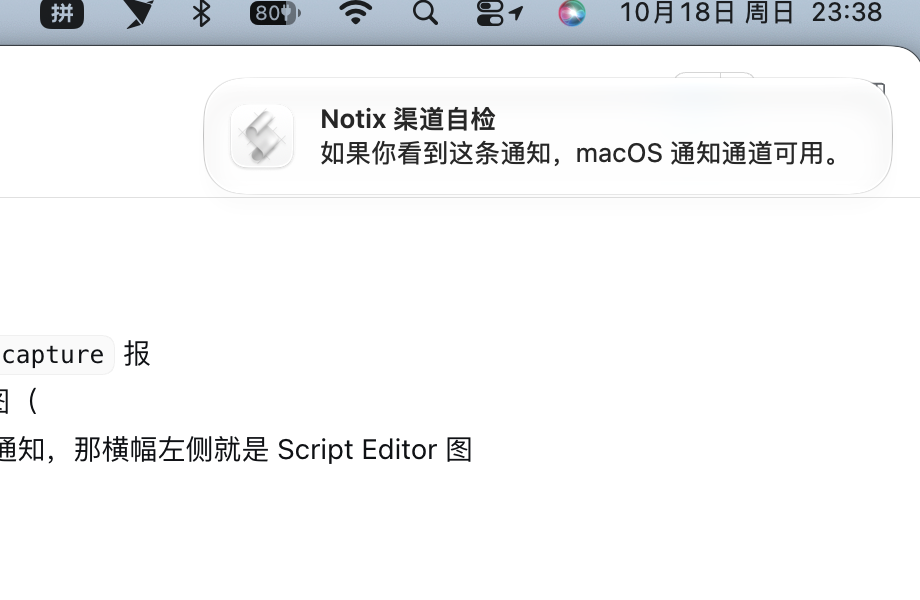
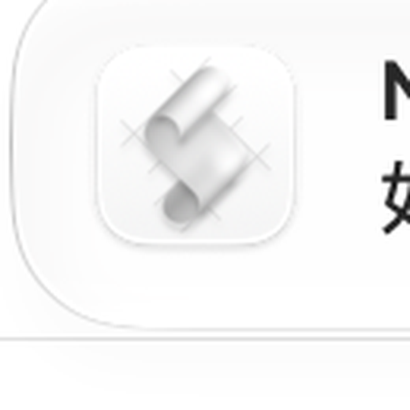

# notix-dsh

[中文](README.zh.md) | English

Desktop notifications for [DeepSeek Harness](https://github.com/deepseek-ai/deepseek-harness): tell me when the agent **needs input**, **runs too long**, **fails**, or **finishes**.

Notix is a pure observer. It never registers an approval/answerer, never appends session events, and never blocks the agent loop. It watches the shared event surfaces and delivers notifications through a pluggable channel registry (macOS system notifications in v1).

## What it watches

| Trigger | Source | Default |
|---|---|---|
| Approval requested | `approval/asked` / `approval/decided` session events | on, 5 min reminder ×2 |
| Question waiting | `userQuestions` session projection (per-session busy tracking) | on, 5 min reminder |
| Long turn | `turn/start` watchdog | on, 10 min |
| Long background job | `job/registered` watchdog | on, 15 min |
| Turn failed | `turn/end` reason `error` + `agent/error` (deduped) | on, 60 s cooldown |
| Tool failure | `tool/result` with `isError` | off (opt-in) |
| Turn completed | `turn/end` reason `completed` | on, ≥3 min turns |
| Job settled | `job/settled` | on |

Deliveries are deduped, rate-limited per session, silenced during quiet hours, and retried with a circuit breaker per channel. Notification history (last 200) is kept in the `notix` storage domain and exposed as `ctx.notix.history()`.

## What it looks like on macOS

The `osascript` channel shows a standard notification banner (bold title + body, floating card at the top-right):



⚠️ The icon on the left is assigned by macOS to the sending process: with `osascript` it is the system **Script Editor** icon, not Notix's own icon (the Notix icon is used for the dsh plugin list/market):



### Show the whale icon in the banner (signing required)

macOS only authorizes code-signed apps for notifications; ad-hoc or unsigned bundles are rejected before any permission prompt appears (`requestAuthorization` returns denied). Build and sign the bundled helper:

```bash
NOTIX_SIGN_IDENTITY="Apple Development: Your Name (TEAMID)" \
  ./scripts/build-notifier-app.sh --install
```

Click **Allow** on the first notification; afterwards the banner shows the Notix whale icon. Without a signing identity the script falls back to ad-hoc and prints a warning — notifications then keep the Script Editor icon. When `terminal-notifier` is installed, the plugin also prefers it and passes `-appIcon`.

## Requirements

- DeepSeek Harness `>=0.2.1-rc.2 <0.3.0`
- macOS for the built-in `macos-system` channel (uses `osascript`; `terminal-notifier`/`alerter` are used when present for click-to-open)

## Install

From the Web GUI sidebar **Plugins** page, install this package, or:

```bash
dsh plugin --profile web add notix-dsh
```

Then make sure the bundle is selected in the profile manifest (`dsh.profile.bundles`). A `link:` install is handy during development:

```bash
dsh plugin --profile web add link:/absolute/path/to/packages/notix-dsh
```

```jsonc
// ~/.dsh/profiles/<name>/package.json
{
  "dsh": { "profile": { "bundles": ["@deepseek-ai/dsh-base", "@deepseek-ai/dsh-web-app", "notix-dsh"] } }
}
```

> Client-side settings UI ships separately as `notix-dsh-ui`; install it the same way to edit thresholds from Settings → Plugins.

## Configuration

Every field is optional; shipped defaults apply. Override in the profile's `cordis.patch.yml` under the same entry id:

```yaml
# ~/.dsh/profiles/<name>/cordis.patch.yml
- id: notix
  name: notix-dsh
  config:
    triggers:
      longTask: { turnThresholdMs: 300000 }
      error: { toolErrors: true, toolTimeout: true }
    quietHours: { enabled: true, from: "23:00", to: "08:00", allowUrgent: true }
    channels:
      macos: { sound: false }
```

| Field | Default | Meaning |
|---|---|---|
| `language` | `zh` | Notification language (`zh` / `en`) |
| `verbosity` | `minimal` | `minimal` omits command/file contents |
| `triggers.approval.remindAfterMs` | `300000` | Reminder delay while an approval stays unanswered |
| `triggers.approval.maxReminders` | `2` | Reminder cap |
| `triggers.userQuestion.remindAfterMs` | `300000` | Reminder delay while a question stays open |
| `triggers.userQuestion.maxReminders` | `2` | Reminder cap |
| `triggers.userQuestion.remindOnContinued` | `true` | Re-notify when a timed question becomes pending |
| `triggers.longTask.turnThresholdMs` | `600000` | Turn watchdog threshold |
| `triggers.longTask.jobs` | `false` | Watch background jobs too (off by default) |
| `triggers.longTask.jobThresholdMs` | `900000` | Background job watchdog threshold |
| `triggers.error.cooldownMs` | `60000` | Per-session error notification cooldown |
| `triggers.error.toolErrors` | `false` | Notify on failed tool results |
| `triggers.error.toolTimeout` | `false` | Notify on `TOOL_TIMEOUT` specifically |
| `triggers.completion.minDurationMs` | `180000` | Only long turns announce completion |
| `triggers.completion.jobs` | `false` | Announce settled background jobs (off by default) |
| `quietHours` | off | Empty window rules; `allowUrgent` lets approvals/questions through |
| `channels.macos.baseUrl` | `""` | GUI URL opened by click-to-open helpers |
| `channels.macos.notifierApp` | `""` → `~/Applications/Notix.app` | Notification helper app bundle |
| `channels.macos.appIcon` | `""` → bundled whale icon | Banner icon passed to terminal-notifier |

## Service API

Other plugins can use `ctx.notix`:

```js
ctx.notix.notify({ title: 'Deploy done', body: 'main is green', urgency: 'normal' })
ctx.notix.registerChannel({ id: 'my-channel', send: async (notification) => { /* ... */ } })
ctx.notix.history(20)
```

## Security and privacy

- Notification bodies default to session title, tool name, and a truncated question/reason — never full command lines or file contents unless `verbosity: normal`.
- The plugin never decides anything: approvals keep their fail-closed semantics, and all decisions stay in the GUI.
- Delivery failures are contained: retries and per-channel circuit breakers, and no error ever reaches the agent loop.

## Development

```bash
pnpm install
pnpm test          # 19 unit/integration tests, including a real Cordis runtime
dsh --profile web --patch ./dev/notix.patch.yml --dump-config
```

`dev/notix.patch.yml` loads the local checkout without installing it (adjust the absolute path if the repository moves).
